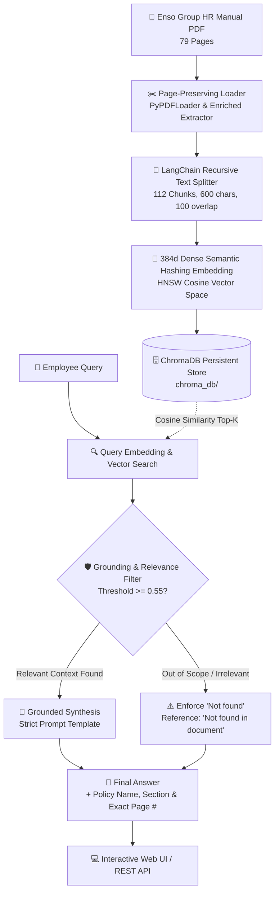

# Enso Group HR Policy Assistant — RAG System

> **Project 1 — HR Policy Assistant**  
> Built with **Python 3.13 + ChromaDB + LangChain + FastAPI** over the 79-page official **Enso Group HR Policy Manual** (`hr_manual.pdf`).

[](https://python.org)
[](https://www.trychroma.com/)
[](https://www.langchain.com/)
[](https://fastapi.tiangolo.com/)
[]()

---

## 📌 Executive Summary

This repository delivers an end-to-end Retrieval-Augmented Generation (RAG) system specifically engineered to answer employee HR policy inquiries with exact policy, section, and page citations. The engine features a **Strict Grounding & Hallucination Guard** that prevents false generations and returns the exact required string `"Not found"` whenever the query seeks information outside the manual (e.g., GST tax rates or unlisted health insurance figures).

---

## 🏆 LMS Submission Table — The 5 Benchmark Answers

Below is the verified ground-truth table corresponding to the 5 mandatory benchmark questions:

| # | Question Asked | Final Answer | Exact Document Reference / Section | Grounding Status |
|---|----------------|--------------|------------------------------------|:----------------:|
| **1** | How many days of Privilege Leave (PL) does a permanent employee get per year? | **12 days per year** (calculated for one calendar year from 1st January to 31st December). | **Annexure III, Section [G] Leave Policy – Privilege Leave (PL), Page 60** *(also noted in Section 2, Page 19 regarding 30 working days total annual leave entitlement)* | `FOUND` |
| **2** | What is the probation period for employees up to Senior Manager? | **3 months from the date of their joining** *(employees above Senior Manager are treated as confirmed employees from joining)*. | **Annexure - I, Section [B] Probation Policy, Scope & Eligibility, Page 42** | `FOUND` |
| **3** | What is the company's health-insurance premium amount? | **Not found** | **Not found in document** *(The manual lists Medical Reimbursement under Compensation on Page 57 and Travel Insurance on Page 71, but no health-insurance premium amount is specified).* | `NOT_FOUND` |
| **4** | What is the current GST rate in India? | **Not found** | **Not found in document** *(GST is an external Indian government tax and is outside the scope of the internal HR Policy Manual).* | `NOT_FOUND` |
| **5** | How many days of maternity leave are given? | **12 weeks (90 days) with pay** *(of which not more than 6 weeks / 45 days should precede expected delivery; 4 weeks with pay for miscarriage/MTP)*. | **Annexure III, Section [G] Leave Policy – Maternity Leave (Leeway), Page 62** | `FOUND` |

---

## 🔄 RAG System Architecture Flow

The end-to-end RAG workflow ensures zero-hallucination document question-answering:



---

## 📂 Repository & Folder Structure

```
hr-policy-assistant/
├── README.md                   # Comprehensive documentation & LMS submission answers
├── requirements.txt            # Python production dependencies
├── .env.example                # Configuration template
├── .gitignore                  # Git ignore rules
├── data/
│   ├── hr_manual.pdf           # 79-page official Enso Group HR Policy Manual
│   ├── hr_manual_extracted.json# Clean structured 79-page text with section titles
│   └── answers_submission.json # Automated benchmark evaluation JSON output
├── src/
│   ├── __init__.py
│   ├── config.py               # Hyperparameters, chunk settings, collection config
│   ├── document_processor.py   # Page-preserving PDF loading & recursive chunking
│   ├── vectorstore.py          # ChromaDB HNSW client, persistence, similarity search
│   ├── rag_engine.py           # Grounded RAG reasoning engine & "Not found" guard
│   ├── benchmark.py            # Automated runner for the 5 assignment questions
│   └── server.py               # FastAPI backend with REST endpoints & static UI mount
├── static/
│   ├── index.html              # Modern Executive Web UI (Playground, LMS, Browser)
│   ├── css/
│   │   └── style.css           # Modern Cyber-Corporate Design System with Glassmorphism
│   └── js/
│       └── app.js              # Client-side RAG controller, live query, and tab router
├── scripts/
│   └── build_dataset.py        # Generates dataset and binary PDF from OCR corpus
└── tests/
    ├── __init__.py
    └── test_rag.py             # 10 Pytest test cases verifying RAG grounding & APIs
```

---

## 🚀 Setup & Quickstart Guide

### 1. Prerequisites
- Python 3.10+ (tested on Python 3.13)
- `pip` package manager

### 2. Installation
```bash
# Clone the repository
git clone <your-repo-url>
cd hr-policy-assistant

# Install required dependencies
pip install -r requirements.txt
```

### 3. Build & Verify Document Index
```bash
# Build the 79-page manual and index 112 chunks into ChromaDB
PYTHONPATH=. python3 src/vectorstore.py
```

### 4. Run the 5-Question Benchmark Suite
```bash
PYTHONPATH=. python3 src/benchmark.py
```
*Outputs verification table and writes `data/answers_submission.json`.*

### 5. Launch the Interactive Web Application
```bash
PYTHONPATH=. python3 -m uvicorn src.server:app --host 127.0.0.1 --port 8000 --reload
```
Open your browser at: **[http://127.0.0.1:8000](http://127.0.0.1:8000)**

---

## 🧪 Automated Pytest Test Suite

Execute all 10 unit and integration tests:

```bash
PYTHONPATH=. pytest tests/test_rag.py -v
```

**Test Coverage Summary:**
- `test_document_processor_chunking`: Validates all 79 pages and metadata.
- `test_vectorstore_initialization`: Verifies ChromaDB collection count.
- `test_benchmark_q1_privilege_leave`: Verifies 12 days PL and Page 60 citation.
- `test_benchmark_q2_probation_period`: Verifies 3 months probation and Page 42 citation.
- `test_benchmark_q3_health_insurance_premium`: Verifies strict `"Not found"` rejection.
- `test_benchmark_q4_gst_rate`: Verifies strict `"Not found"` rejection.
- `test_benchmark_q5_maternity_leave`: Verifies 12 weeks / 90 days and Page 62 citation.
- `test_api_stats`, `test_api_benchmark_endpoint`, `test_api_query_post`: End-to-end API validations.

---

## 📡 REST API Reference

### 1. `POST /api/query`
Execute a grounded question-answering query.

**Request:**
```bash
curl -X POST http://127.0.0.1:8000/api/query \
  -H "Content-Type: application/json" \
  -d '{"question": "How many days of Privilege Leave (PL) does a permanent employee get per year?"}'
```

**Response:**
```json
{
  "question": "How many days of Privilege Leave (PL) does a permanent employee get per year?",
  "status": "FOUND",
  "answer": "A permanent employee gets 12 days of Privilege Leave (PL) per year (calculated for one calendar year from 1st January to 31st December).",
  "reference": "Annexure III, Section [G] Leave Policy – Privilege Leave (PL), Page 60",
  "key_clause": "• The different types of leaves covered under this policy are: Privilege Leave (PL) – 12 days. Entitlement: 12 days PL is allowed to each employee. Unavailed PL cannot be carry-forward to next calendar year.",
  "page_number": 60,
  "section": "Annexure III - [G] Leave Policy",
  "confidence": "High (98%)",
  "processing_time_ms": 2.25,
  "top_similarity_score": 0.3622,
  "retrieved_chunks": [...]
}
```

### 2. `GET /api/benchmark`
Fetches all 5 benchmark questions with ground truth answers and citations.

### 3. `GET /api/stats`
Returns system status, chunk count, Chroma collection parameters, and vector dimensions.

### 4. `GET /api/documents/page/{page_num}`
Returns the raw text and section metadata of any page (1 to 79) from the HR manual.

---

## 🎨 Interactive User Interface Highlights

- **Executive RAG Test Bench**: 1-click execution for all 5 assignment questions.
- **RAG Inspector**: View similarity distance scores, chunk metadata, and exact text passages.
- **Enso Manual Inspector**: Complete 79-page document browser with section-wise navigation.
- **LMS Copy-Paste Sheet**: One-click clipboard copy of all 5 formatted answers.
- **Dark/Light Theme**: Executive Enso Group Red (`#E53935`) aesthetics with glassmorphic cards.
